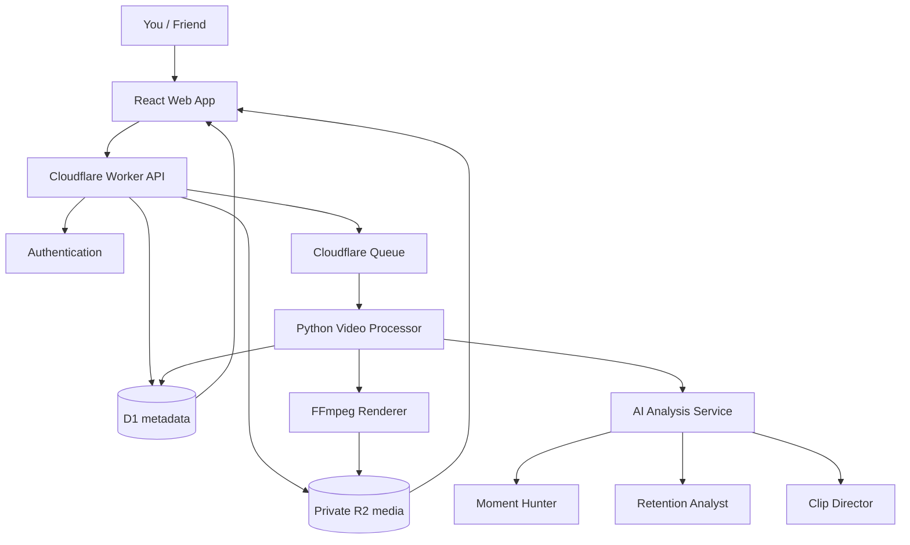

# ClipForge AI Architecture

## Design principle
Keep the MVP modular but simple: one API, one processor, and AI capabilities as functions—not separate autonomous agents.

## System

## Components
- **Web:** dashboard, upload, job progress, candidate review, clip library, playback/export, settings.
- **API:** authenticate and authorize requests, create uploads/jobs, enqueue work, return metadata and short-lived media access. No heavy FFmpeg work in Workers.
- **D1:** users, jobs, candidate timestamps, clip metadata, status, scores, storage keys. Never store video bytes.
- **R2:** original videos and exports; keep buckets private.
- **Queue:** async processing, retry, progress tracking; jobs should be idempotent.
- **Processor:** separate Python runtime handles transcription, analysis, FFmpeg, storage and DB updates.

## AI modules
1. **Moment Hunter:** finds candidate timestamp ranges from transcript and audiovisual cues.
2. **Retention Analyst:** estimates hook, context, pacing and payoff.
3. **Clip Director:** suggests boundaries, title and crop guidance.

These are ordinary modules/functions inside one analysis service. Scores are estimates, never guarantees of virality; human review is required.

## Processing flow
1. Upload authorized video to private storage.
2. API records source and creates a queued job.
3. Queue invokes processor.
4. Processor transcribes when possible and proposes moments.
5. AI modules evaluate candidates and suggest boundaries/titles.
6. User reviews/selects a candidate.
7. FFmpeg cuts it and optionally adds captions or 9:16 framing.
8. Export is stored in R2; metadata/status saved in D1.
9. Web app provides authorized playback/download.

## Security
- Private repository/storage and authenticated access.
- Check ownership/group access on every resource endpoint.
- Keep AI/provider keys server-side in secrets.
- Validate file types/sizes and bound processing resources.
- Use only media you own or have permission to process; do not bypass platform access controls.

## Build order
UI shell → auth/upload/storage → first clipping pipeline → subtitles/vertical polish → live radar.