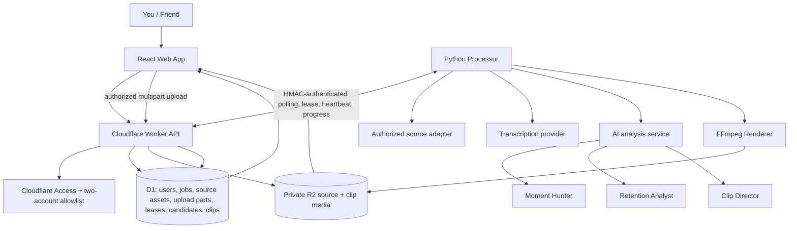

# ClipForge AI Architecture

## Design principle
Keep the MVP modular but simple: one API, one Python processor initially, and AI capabilities as functions—not separate autonomous agents.

## System

## Components
- **Web:** dashboard, job progress, candidate review, clip library, playback/export, settings. Each of the two accounts sees only its own resources.
- **API:** authenticate and authorize requests, create jobs, expose status and short-lived media access, and provide HMAC-authenticated processor endpoints. No heavy FFmpeg work in Workers.
- **D1:** users, jobs, source-asset ownership/upload state, multipart part records, lease state, candidate timestamps, clip metadata, status, scores and storage keys. It is the single source of truth for job dispatch. Never store video bytes.
- **R2:** original videos and exports; keep buckets private.
- **Processor:** separate Python runtime handles authorized media acquisition, transcription, analysis, FFmpeg, storage and progress callbacks. It starts with one active job to protect a small CPU-only machine.
- **Job dispatch:** Python polls the Worker API. The Worker atomically claims a queued D1 row and returns a short-lived per-job lease token. Heartbeats extend the lease; expired leases are retried up to the configured attempt limit. There is no external Queue consumer in this initial architecture.

## AI modules
1. **Moment Hunter:** finds candidate timestamp ranges from transcript and audiovisual cues.
2. **Retention Analyst:** estimates hook, context, pacing and payoff.
3. **Clip Director:** suggests boundaries, title and crop guidance.

These are ordinary modules/functions inside one analysis service. Scores are estimates, never guarantees of virality; human review is required.

## Processing flow
1. User submits one or more supported source URLs; jobs begin in `review` / `awaiting_source_asset` so the processor cannot claim them prematurely.
2. User uploads an original/export or other provider-approved file they have permission to process. The API creates an owner-scoped R2 multipart upload with fixed 8 MiB chunks, a 2 GiB per-file limit and an 8 GiB per-user limit.
3. The API records multipart parts and ETags in D1, verifies every expected part and size, then finalizes the private R2 object.
4. The user attaches the ready asset to the matching job. The API checks job ownership, asset ownership, readiness and one-asset/one-job uniqueness before queuing it.
5. Python polls the internal API and atomically claims only queued jobs with a ready, owner-matched asset.
6. Processor parses the platform video/VOD ID and retrieves metadata only from the official YouTube Data API or Twitch Helix API.
7. Active/upcoming live sources are rejected for this VOD-only milestone. Metadata does not prove that the uploaded file matches the platform source or that the user has rights; the user is responsible for providing media they are authorized to process.
8. The processor streams the attached private R2 object only under the current owner-matched job lease, then FFprobe validates the actual video/audio streams, duration and dimensions.
9. FFmpeg extracts mono 16 kHz PCM WAV audio to a private persistent scratch volume partitioned by user UUID and job UUID; the temporary downloaded source is removed after successful extraction. D1 stores validated probe/audio metadata and the job transitions to `review` / `audio_extracted`.
10. Transcription and AI modules evaluate candidate moments and suggest boundaries/titles; FFmpeg renders vertical clips and subtitles.
11. Exports are stored in private R2; metadata/status are saved in D1, and the web app provides owner-authorized playback/download.
9. AI modules evaluate candidates and suggest boundaries/titles; FFmpeg renders vertical clips and subtitles.
10. Exports are stored in private R2; metadata/status are saved in D1, and the web app provides owner-authorized playback/download.

## Cancellation and recovery
- A queued job is marked cancelled immediately.
- A processing job receives `cancel_requested=1`; the processor observes it in heartbeat responses and stops at safe stage boundaries.
- Each claim has a lease ID, a random lease token (only its SHA-256 hash is stored), expiry and attempt count.
- Expired leases are requeued until `max_attempts` is reached; exhausted jobs become failed.
- Pipeline stages and clip writes must be idempotent before real media processing is enabled.

## Security
- Every user-facing resource query is scoped to the authenticated user ID.
- Processor endpoints require timestamped HMAC-SHA256 authentication with a one-time nonce, plus a job-scoped lease token.
- Keep provider keys and processor shared secrets server-side in secrets.
- The current metadata adapters never fetch user-submitted platform URLs; they call fixed official API hosts. Any future media-file URL fetch must independently validate every redirect and DNS answer, pin the resolved public IP to the connection, and reject private/reserved/link-local/cloud-metadata destinations.
- Bound source duration, file size, scratch usage and processing time.
- Keep R2 objects private and use short-lived authorized download URLs.
- Use only media you own or have permission to process; do not bypass platform access controls.

## Build order
UI shell → auth and D1 job lifecycle → processor polling/lease smoke test → authorized VOD ingestion → transcription and candidate detection → FFmpeg rendering → private R2 publishing → live capture for authorized sources.
