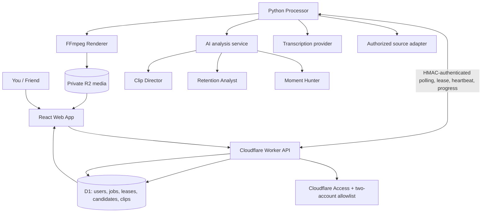

# ClipForge AI Architecture

## Design principle
Keep the MVP modular but simple: one API, one Python processor initially, and AI capabilities as functions—not separate autonomous agents.

## System

## Components
- **Web:** dashboard, job progress, candidate review, clip library, playback/export, settings. Each of the two accounts sees only its own resources.
- **API:** authenticate and authorize requests, create jobs, expose status and short-lived media access, and provide HMAC-authenticated processor endpoints. No heavy FFmpeg work in Workers.
- **D1:** users, jobs, lease state, candidate timestamps, clip metadata, status, scores and storage keys. It is the single source of truth for job dispatch. Never store video bytes.
- **R2:** original videos and exports; keep buckets private.
- **Processor:** separate Python runtime handles authorized media acquisition, transcription, analysis, FFmpeg, storage and progress callbacks. It starts with one active job to protect a small CPU-only machine.
- **Job dispatch:** Python polls the Worker API. The Worker atomically claims a queued D1 row and returns a short-lived per-job lease token. Heartbeats extend the lease; expired leases are retried up to the configured attempt limit. There is no external Queue consumer in this initial architecture.

## AI modules
1. **Moment Hunter:** finds candidate timestamp ranges from transcript and audiovisual cues.
2. **Retention Analyst:** estimates hook, context, pacing and payoff.
3. **Clip Director:** suggests boundaries, title and crop guidance.

These are ordinary modules/functions inside one analysis service. Scores are estimates, never guarantees of virality; human review is required.

## Processing flow
1. User submits a supported source URL or uploads authorized media.
2. API validates the submitted URL host, creates a user-scoped queued job in D1.
3. Python polls the internal API and atomically claims a job using a lease.
4. Processor validates source authorization and network destinations before media acquisition.
5. Processor probes and transcribes when possible, then proposes candidate moments.
6. AI modules evaluate candidates and suggest boundaries/titles.
7. FFmpeg cuts the selected moments and optionally adds captions or 9:16 framing.
8. Export is stored in private R2; metadata/status are saved in D1 through authenticated callbacks.
9. Web app provides authorized playback/download.

## Cancellation and recovery
- A queued job is marked cancelled immediately.
- A processing job receives `cancel_requested=1`; the processor observes it in heartbeat responses and stops at safe stage boundaries.
- Each claim has a lease ID, a random lease token (only its SHA-256 hash is stored), expiry and attempt count.
- Expired leases are requeued until `max_attempts` is reached; exhausted jobs become failed.
- Pipeline stages and clip writes must be idempotent before real media processing is enabled.

## Security
- Every user-facing resource query is scoped to the authenticated user ID.
- Processor endpoints require timestamped HMAC-SHA256 authentication and a job-scoped lease token.
- Keep provider keys and processor shared secrets server-side in secrets.
- Validate source URLs again in the processor, including redirects, DNS answers and private/reserved IP destinations, before any future network fetch.
- Bound source duration, file size, scratch usage and processing time.
- Keep R2 objects private and use short-lived authorized download URLs.
- Use only media you own or have permission to process; do not bypass platform access controls.

## Build order
UI shell → auth and D1 job lifecycle → processor polling/lease smoke test → authorized VOD ingestion → transcription and candidate detection → FFmpeg rendering → private R2 publishing → live capture for authorized sources.
